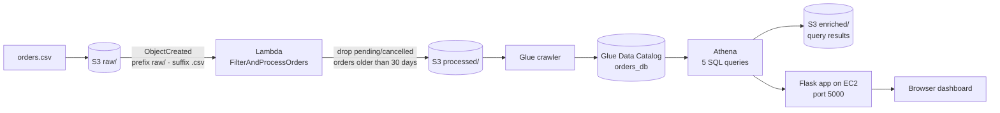

# AWS S3 → Lambda → Glue → Athena Data Pipeline

An end-to-end AWS analytics pipeline. Raw order files landing in **S3** are filtered by an event-driven **Lambda** function, cataloged by a **Glue crawler**, queried with **Athena** SQL, and served as a live dashboard from a **Flask app on EC2**.


## Problem

Order data arrives as raw CSVs full of stale records (old *pending* and *cancelled* orders) that distort revenue reporting. The business needs those records removed automatically on arrival, the clean data made queryable with SQL without managing a database, and the key metrics shown on a page anyone can open.

## Architecture



## Tech stack

| Area | Tools |
|---|---|
| Storage | Amazon S3 (`raw/` → `processed/` → `enriched/` zones) |
| Processing | AWS Lambda (Python, `boto3`, S3 event trigger) |
| Catalog | AWS Glue crawler + Data Catalog |
| Query | Amazon Athena (Presto SQL) |
| Serving | Amazon EC2 (Amazon Linux 2023, t2.micro), Flask, `boto3` |
| Security | IAM roles per service (Lambda, Glue, EC2 instance profile) |

## Results

From the 200-order sample ([`Input File/orders.csv`](Input%20File/orders.csv); query outputs in [`Output File/`](Output%20File/)):

| Metric | Value |
|---|---|
| Orders kept after Lambda filtering | **109 of 200** (91 stale pending/cancelled orders removed) |
| Status mix after filtering | 63 confirmed · 46 shipped |
| Top customer by total sales | Bob, **$9,211.69** (AOV $307.06) |
| Busiest month | Feb 2025: 41 orders, **$11,917.41** revenue |
| Largest February order | O0001, Bob, $478.65 |

> The Lambda's 30-day cutoff is relative to when it runs, so rerunning it later can filter a different number of records.

## Screenshots

**Athena dashboard served from EC2**


The console screenshots for each setup step are embedded in the step-by-step guide below and stored in [`Output Screenshots/`](Output%20Screenshots/).

## Repo structure

```
.
├── LambdaFunction.py        # S3-triggered filter: raw/ → processed/
├── EC2NanoApp.py            # Flask dashboard that runs the 5 Athena queries
├── Input File/orders.csv    # sample input (200 orders)
├── Output File/Query1-5.csv # Athena query results
└── Output Screenshots/      # step-by-step console screenshots
```

## How to run: step by step

### 1. Amazon S3 Bucket Structure 🪣

First, set up an S3 bucket with the following folder structure to manage the data workflow:

* **`bucket-name/`**
    * **`raw/`**: For incoming raw data files.
    * **`processed/`**: For cleaned and filtered data output by the Lambda function.
    * **`enriched/`**: For storing athena query results.


---

### 2. IAM Roles and Permissions 🔐

Create the following IAM roles to grant AWS services the necessary permissions to interact with each other securely.

#### Lambda Execution Role

1.  Navigate to **IAM** -> **Roles** and click **Create role**.
2.  **Trusted entity type**: Select **AWS service**.
3.  **Use case**: Select **Lambda**.
4.  **Add Permissions**: Attach the following managed policies:
    * `AWSLambdaBasicExecutionRole`
    * `AmazonS3FullAccess`
5.  Give the role a descriptive name (e.g., `Lambda-S3-Processing-Role`) and create it.


#### Glue Service Role

1.  Create another IAM role for **AWS service** with the use case **Glue**.
2.  **Add Permissions**: Attach the following policies:
    * `AmazonS3FullAccess`
    * `AWSGlueConsoleFullAccess`
    * `AWSGlueServiceRole`
3.  Name the role (e.g., `Glue-S3-Crawler-Role`) and create it.


#### EC2 Instance Profile

1.  Create a final IAM role for **AWS service** with the use case **EC2**.
2.  **Add Permissions**: Attach the following policies:
    * `AmazonS3FullAccess`
    * `AmazonAthenaFullAccess`
3.  Name the role (e.g., `EC2-Athena-Dashboard-Role`) and create it.


---

### 3. Create the Lambda Function ⚙️

This function will automatically process files uploaded to the `raw/` S3 folder.

1.  Navigate to the **Lambda** service in the AWS Console.
2.  Click **Create function**.
3.  Select **Author from scratch**.
4.  **Function name**: `FilterAndProcessOrders`
5.  **Runtime**: Select **Python 3.9** (or a newer version).
6.  **Permissions**: Expand *Change default execution role*, select **Use an existing role**, and choose the **Lambda Execution Role** you created.
7.  Click **Create function**.
8.  In the **Code source** editor, replace the default code with the code from [`LambdaFunction.py`](LambdaFunction.py) for processing the raw data.


---

### 4. Configure the S3 Trigger ⚡

Set up the S3 trigger to invoke your Lambda function automatically.

1.  In the Lambda function overview, click **+ Add trigger**.
2.  **Source**: Choose **S3**.
3.  **Bucket**: Select your S3 bucket.
4.  **Event types**: Choose **All object create events**.
5.  **Prefix (Required)**: Enter `raw/`. This ensures the function only triggers for files in this folder.
6.  **Suffix (Recommended)**: Enter `.csv`.
7.  Check the acknowledgment box and click **Add**.


--- 
**Start Processing of Raw Data**: Now upload [`Input File/orders.csv`](Input%20File/orders.csv) into the `raw/` folder of the S3 Bucket. This will automatically trigger the Lambda function.
---


### 5. Create a Glue Crawler 🕸️

The crawler will scan your processed data and create a data catalog, making it queryable by Athena.

1.  Navigate to the **AWS Glue** service.
2.  In the left pane, select **Crawlers** and click **Create crawler**.
3.  **Name**: `orders_processed_crawler`.
4.  **Data source**: Point the crawler to the `processed/` folder in your S3 bucket.
5.  **IAM Role**: Select the **Glue Service Role** you created earlier.
6.  **Output**: Click **Add database** and create a new database named `orders_db`.
7.  Finish the setup and run the crawler. It will create a new table in your `orders_db` database.


---

### 6. Query Data with Amazon Athena 🔍

Navigate to the **Athena** service. Ensure your data source is set to `AwsDataCatalog` and the database is `orders_db`. You can now run SQL queries on your processed data.

**Queries to be executed:**
* **Total Sales by Customer**: Calculate the total amount spent by each customer.
* **Monthly Order Volume and Revenue**: Aggregate the number of orders and total revenue per month.
* **Order Status Dashboard**: Summarize orders based on their status (`shipped` vs. `confirmed`).
* **Average Order Value (AOV) per Customer**: Find the average amount spent per order for each customer.
* **Top 10 Largest Orders in February 2025**: Retrieve the highest-value orders from a specific month.


---

### 7. Launch the EC2 Web Server 🖥️

This instance will host a simple web page to display the Athena query results.

1.  Navigate to the **EC2** service and click **Launch instance**.
2.  **Name**: `Athena-Dashboard-Server`.
3.  **Application and OS Images**: Select **Amazon Linux 2023 AMI**.
4.  **Instance type**: Choose **t2.micro** (Free tier eligible).
5.  **Key pair (login)**: Create and download a new key pair. **Save the `.pem` file!**
6.  **Network settings**: Click **Edit** and configure the security group:
    * **Rule 1 (SSH)**: Type: `SSH`, Port: `22`, Source: `My IP`.
    * **Rule 2 (Web App)**: Click **Add security group rule**.
        * Type: `Custom TCP`
        * Port Range: `5000`
        * Source: `Anywhere` (`0.0.0.0/0`)
7.  **Advanced details**: Scroll down and for **IAM instance profile**, select the **EC2 Instance Profile** you created.
8.  Click **Launch instance**.

---

### 8. Connect to Your EC2 Instance

1.  From the EC2 dashboard, select your instance and copy its **Public IPv4 address**.
2.  Open a terminal or SSH client and connect using your key pair:

    ```bash
    ssh -i /path/to/your-key-file.pem ec2-user@YOUR_PUBLIC_IP_ADDRESS
    ```


### 9. Set Up the Web Environment

Once connected via SSH, run the following commands to install the necessary software.

1.  **Update system packages**:
    ```bash
    sudo yum update -y
    ```
2.  **Install Python and Pip**:
    ```bash
    sudo yum install python3-pip -y
    ```
3.  **Install Python libraries (Flask & Boto3)**:
    ```bash
    pip3 install Flask boto3
    ```

---

### 10. Create and Configure the Web Application

1.  Create the application file using the `nano` text editor:
    ```bash
    nano app.py
    ```
2.  Copy and paste your Python web application code ([`EC2NanoApp.py`](EC2NanoApp.py)) into the editor.

3.  ‼️ **Important**: Update the placeholder variables at the top of the script:
    * `AWS_REGION`: Your AWS region (e.g., `us-east-1`).
    * `ATHENA_DATABASE`: The name of your Glue database (e.g., `orders_db`).
    * `S3_OUTPUT_LOCATION`: The S3 URI for your Athena query results (e.g., `s3://your-athena-results-bucket/`).

4.  Save the file and exit `nano` by pressing `Ctrl + X`, then `Y`, then `Enter`.

---

### 11. Run the App and View Your Dashboard! 🚀

1.  Execute the Python script to start the web server:
    ```bash
    python3 app.py
    ```
    You should see a message like `* Running on http://0.0.0.0:5000/`.

2.  Open a web browser and navigate to your instance's public IP address on port 5000:
    ```
    http://YOUR_PUBLIC_IP_ADDRESS:5000
    ```
    You should now see your Athena Orders Dashboard!


---

### Important Final Notes

* **Stopping the Server**: To stop the Flask application, return to your SSH terminal and press `Ctrl + C`.
* **Cost Management**: This setup uses free-tier services. To prevent unexpected charges, **stop or terminate your EC2 instance** from the AWS console when you are finished.
